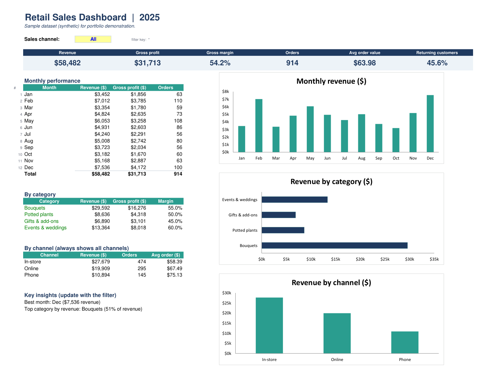

# Retail Sales Dashboard in Excel

A one-page sales dashboard built with Excel formulas only: no macros, no add-ins, no pivot-table refreshes. Pick a sales channel in one cell and every KPI, table, chart and insight updates.

> Portfolio project. **The data is synthetic** (914 orders of a small retail shop in 2025). The same dataset is used in the other projects in this portfolio.

## What it shows

- **Six KPIs:** revenue, gross profit, gross margin, orders, average order value, returning customers.
- **Monthly performance:** revenue, gross profit and orders per month, with a chart.
- **By category:** revenue, gross profit and margin, with a chart.
- **By channel:** revenue, orders and average order for in-store, online and phone. This block always shows all three channels, so they can be compared while the rest of the page is filtered.
- **Key insights:** text built by formulas (best month, top category and its share) that rewrites itself for the selected channel.

## How it works

| Sheet | Contents |
|---|---|
| Dashboard | The page above. The **Sales channel** cell (C4) is the only input: All, In-store, Online or Phone. |
| Data | 914 orders with revenue, cost of goods and gross profit calculated by formulas. |
| Assumptions | Cost of goods as % of revenue per category. Change a % and gross profit updates everywhere. |

All figures come from `SUMIFS` / `COUNTIFS` over the Data sheet, filtered by the channel cell, and the text insights use `INDEX` / `MATCH` / `TEXT`. Nothing is hard-coded on the dashboard.

## Control figures (channel = All)

Revenue $58,482.14 · gross profit $31,712.54 · margin 54.2% · 914 orders · average order $63.98 · returning customers 45.6%. By channel: in-store $27,679 (474 orders), online $19,909 (295), phone $10,894 (145).

These match the Python, Power BI and HTML versions of the same report.

## Files

- `Retail_Sales_Dashboard_2025.xlsx`: the workbook.
- `Retail_Sales_Dashboard_2025.pdf`: the dashboard page as a PDF.
- `screenshots/excel_dashboard.png`: an image for the portfolio.
