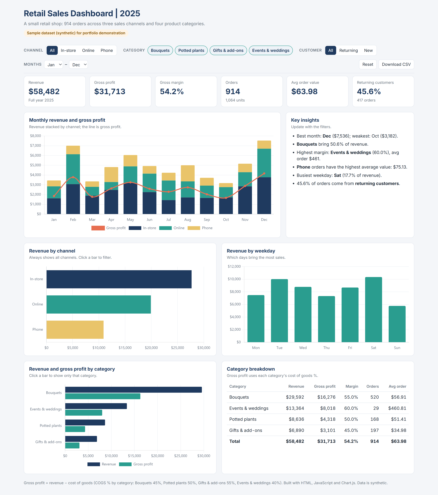

# Interactive Retail Sales Dashboard (HTML)

A single-file interactive dashboard that runs in any browser: no Power BI licence, no server, no install. It can be emailed, attached, or hosted on GitHub Pages.

> Portfolio project. The data is synthetic: the same 914 orders as my Excel and Power BI *Retail Sales Dashboard* and the *Sales Report Automation* script.



## What it shows

- **KPIs:** revenue, gross profit, gross margin, orders and units, average order value, share of returning customers.
- **Monthly revenue** stacked by sales channel, with a gross profit line.
- **Revenue by channel.** It always shows all three channels; click a bar to filter by it.
- **Revenue by weekday.**
- **Revenue and gross profit by category,** plus a breakdown table. Click a bar to focus on one category.
- **Key insights** written automatically and updated with every filter: best and weakest month, top category share, highest margin, highest average order, busiest weekday.

Filters: channel, category (multi-select), customer type (new / returning), month range. **Reset** returns to the full view, and **Download CSV** exports the orders that match the current filters.

Works on desktop and mobile (tested at 375 px wide).

## Verification

Every KPI was checked against an independent pandas calculation for eight filter combinations (all data, each channel, returning customers, one category, a single month, Q2 + Online), with no difference. With no filters the dashboard shows exactly the control figures of the Excel and Power BI versions: revenue $58,482, gross profit $31,713, margin 54.2%, 914 orders, average order $63.98, returning customers 45.6%. Revenue is summed in cents, so there is no floating-point drift.

## Files

| File | What it is |
|---|---|
| `index.html` | The dashboard, with the data embedded. Open it in a browser. |
| `template.html` | The page layout, styles and JavaScript, without data. |
| `build_dashboard.py` | Embeds `data/Orders.csv` and `data/Categories.csv` into the template and writes `index.html`. |
| `data/` | The synthetic source data. |
| `screenshots/` | An image for the portfolio. |

To rebuild after the data changes:

```bash
python build_dashboard.py
```

For a real client, the same build step can read the clean `Orders.csv` that the Sales Report Automation script produces. The dashboard then refreshes after every monthly run.

## Stack

HTML, CSS, JavaScript, Chart.js 4 (from cdnjs), Python (standard library only) for the build step.
