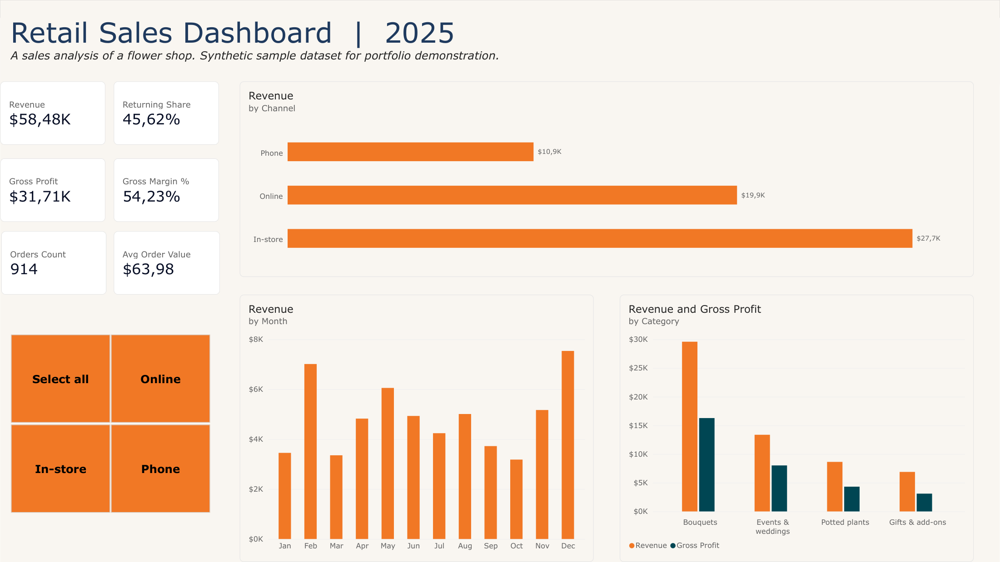

# Retail Sales Dashboard in Power BI

The same one-page sales dashboard as the Excel version, rebuilt in Power BI Desktop with a data model, a date table and DAX measures.

> Portfolio project. **The data is synthetic** (914 orders of a small retail shop in 2025). The same dataset is used in the other projects in this portfolio.



## What it shows

- **Six KPI cards:** revenue, gross profit, gross margin, orders, average order value, share of returning customers.
- **Revenue by channel**, **revenue by month**, and **revenue and gross profit by category**.
- A **channel slicer** (in-store, online, phone) that filters the whole page.

## Data model

| Table | Role |
|---|---|
| `Orders` | One row per order: date, channel, category, customer type, units, unit price (`Orders.csv`) |
| `Categories` | Cost of goods as % of revenue per category (`Categories.csv`) |
| `Date` | A calendar table for 2025, marked as the date table, with month names sorted by month number |

Relationships: `Orders[Date]` → `Date[Date]` and `Orders[Category]` → `Categories[Category]` (many-to-one).

## Measures (DAX)

The measures follow this logic:

```DAX
Revenue = SUMX(Orders, Orders[Units] * Orders[UnitPrice])
COGS = SUMX(Orders, Orders[Units] * Orders[UnitPrice] * RELATED(Categories[COGS_Pct]))
Gross Profit = [Revenue] - [COGS]
Gross Margin % = DIVIDE([Gross Profit], [Revenue])
Orders Count = DISTINCTCOUNT(Orders[OrderID])
Avg Order Value = DIVIDE([Revenue], [Orders Count])
Returning Share = DIVIDE(CALCULATE([Orders Count], Orders[Customer] = "Returning"), [Orders Count])
```

Because every figure is a measure, not a stored value, it recalculates for any slicer selection. Cost of goods comes from the `Categories` table: change one percentage and gross profit updates everywhere.

## Control figures (all channels)

Revenue $58,482 · gross profit $31,713 · margin 54.2% · 914 orders · average order $63.98 · returning customers 45.6%. By channel: in-store $27.7K, online $19.9K, phone $10.9K. These match the Excel, Python and HTML versions of the same report.

## Files

- `Retail_Sales_Dashboard_2025.pbix`: the report (open with the free Power BI Desktop).
- `Retail_Sales_Dashboard_2025.pdf`: the report page as a PDF.
- `Orders.csv`, `Categories.csv`: the source data.
- `screenshots/powerbi_dashboard.png`: an image for the portfolio.
