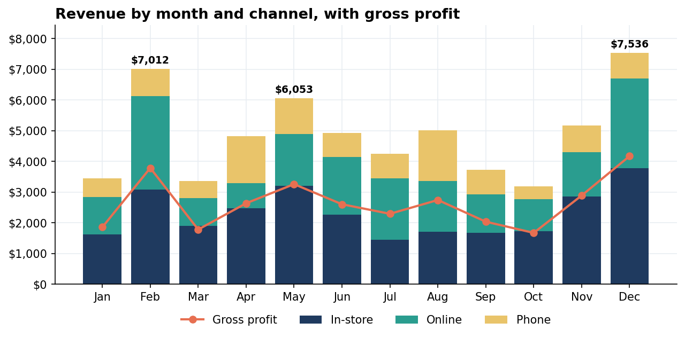

# Retail Sales Analysis 2025 (Python, pandas)

An analytical report in a Jupyter notebook: six business questions about one year of a small retail shop's sales, answered with pandas and matplotlib, ending with concrete recommendations.

> Portfolio project. **The data is synthetic**: the same 914 orders as my Excel / Power BI / HTML dashboards and the Sales Report Automation script. The findings are true for this dataset; the methods carry over to real data.



## Questions answered

1. **Is the data usable?** Gaps, duplicates, date range, missing cost assumptions.
2. **Headline numbers:** revenue, gross profit, margin, orders, average and median order, returning customers.
3. **When does the shop earn?** Monthly seasonality and the weight of holiday weeks.
4. **What earns the profit?** Each category's share of orders, revenue and gross profit.
5. **How do the sales channels differ?** Order value, loyalty and product mix per channel.
6. **New vs returning customers.**
7. **Weekdays and order size.**
8. **Recommendations.**

## Key findings (synthetic data)

- February, May and December bring **35%** of annual revenue. Valentine's week alone is **47%** of February.
- Events & weddings are **3%** of orders but **25%** of gross profit, and the weakest month (October) had no event orders at all.
- Gifts & add-ons are **22%** of orders but only **10%** of profit, which makes them better as add-ons to bouquets.
- Phone orders have the **highest average value ($75)** and the **most returning customers (53%)**.
- Sunday has the fewest orders but the **largest average basket ($74)**.

## Files

| File | For whom |
|---|---|
| `sales_analysis_report.pdf` / `.html` | The report without code, as a business owner would read it |
| `sales_analysis_with_code.html` | The full notebook with code, as a static page |
| `sales_analysis.ipynb` | The executed notebook (GitHub shows it with outputs) |
| `figures/` | The charts as PNG images |
| `data/` | The synthetic source data |

## Verification

The notebook runs top to bottom without errors or warnings. The headline numbers match the Excel, Power BI and HTML dashboards built on the same data: revenue $58,482.14, gross profit $31,712.54, margin 54.2%, 914 orders, average order $63.98, returning customers 45.6%. Every figure quoted in the text was checked against the notebook's own output.

## Run it yourself

```bash
python -m venv .venv
.venv\Scripts\python -m pip install -r requirements.txt
.venv\Scripts\jupyter notebook sales_analysis.ipynb
```

## Stack

Python, pandas, matplotlib, Jupyter, nbconvert.
